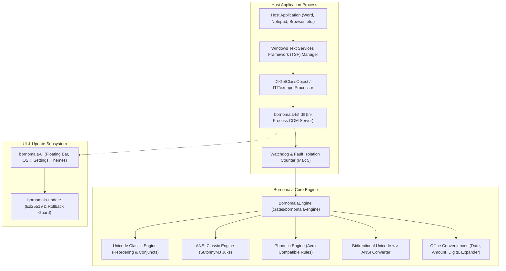

# Bornomala Architecture & Design

**Author:** Ryan Shelby  
**Organization:** Ruposhi Open Labs (`github.com/RuposhiOpenLabs`)  
**License:** GPL-3.0-or-later  

---

## 1. High-Level Subsystem Architecture

Bornomala is engineered as a zero-dependency, modular, pure-Rust platform. The core input method engine is completely decoupled from operating system APIs, allowing it to run across modern Windows desktop applications, terminal tools, and automated validation suites on Linux.

---

## 2. Text Services Framework (TSF) vs. Legacy Global Hooks

Legacy Bangla typing software from the 1990s and 2000s relies on global Windows low-level keyboard hooks (`SetWindowsHookEx(WH_KEYBOARD_LL)`), injecting keystrokes back via `keybd_event` or `SendInput`.

### Disadvantages of the Legacy Hook Approach:
1. **Severe Latency & Race Conditions:** Injecting synthesized backspaces and virtual keys produces typing lag and dropped keystrokes in modern multi-threaded apps.
2. **Security & Anti-Virus Heuristics:** Modern Endpoint Detection & Response (EDR) software flags `WH_KEYBOARD_LL` as keylogger behavior.
3. **Privilege Elevation Failures:** A hook running at standard user privilege cannot inject input into elevated administrative applications or UAC prompts.
4. **No Inline Composition Context:** Hooks cannot communicate with the modern text caret to draw inline underlines, candidate lists, or suggestion tooltips.

### Bornomala's Modern TSF Approach:
* **Native In-Process COM Server:** Implements standard Windows Text Services Framework (`ITfTextInputProcessor`, `ITfKeyEventSink`).
* **Direct Caret & Buffer Manipulation:** Uses `ITfEditSession` to replace, insert, or set composition ranges directly in the host's text store.
* **Full Privilege Sandbox Compatibility:** Runs seamlessly in standard user windows, elevated consoles, and Windows Store / Universal Windows Platform (UWP) apps.

---

## 3. Typing Engines & State Machines

### 3.1 Classic Fixed Layout (Unicode Output)
* **Pre-base Vowel Reordering:** Vowel signs `ি` (i-kar), `ে` (e-kar), and `ৈ` (oi-kar) are typed in traditional visual order (before the consonant), but canonical Unicode standard requires vowel signs to be stored *after* the consonant cluster. The engine buffers the pre-base vowel sign, accepts the consonant or hasanta conjunct, and automatically emits the base cluster followed by the vowel sign.
* **Split Vowel Construction:** Typing `ে` (key `c`), followed by a consonant (e.g. `ক` / key `j`), followed by `া` (key `f`) triggers a component replacement of `কে` with `কো` (o-kar / `U+09CB`).
* **Reph Logic:** Typing `র্` (Shift+A) buffers the Reph state and attaches `র` + `্` to the head of the subsequent consonant cluster.
* **Backspace Engine:** Supports user-selectable **Atomic** mode (deletes the entire conjunct or cluster at once) or **Component** mode (deletes only the trailing code point).

### 3.2 Classic Fixed Layout (ANSI Output)
* Directly produces 8-bit glyph sequences mapped to legacy Bangla fonts (SutonnyMJ).
* Multi-key Juk engine monitors the active buffer up to 3 keys back to substitute multi-glyph combinations (e.g. `K` + `&` + `K` -> `°` for `ক্ক`).

### 3.3 Phonetic Engine (Avro Compatible)
* Evaluates 289 contextual rules using prefix and suffix scope conditions (`punctuation`, `vowel`, `consonant`, `exact`).
* Local unencrypted learning dictionary ranks completions without sending telemetry or querying external servers.

### 3.4 Bidirectional Converter
* **Unicode to ANSI:** Re-positions Reph, extracts pre-base vowels (`ি`, `ে`, `ৈ`) to visual positions, expands split vowels (`ো`, `ৌ`), substitutes conjunct glyphs, and maps single characters.
* **ANSI to Unicode:** Scans forward over consonant clusters to relocate visual pre-base glyphs (`w`, `‡`, `‰`), merges split sign pairs (`‡...v`), decomposes conjunct glyphs, and performs NFC normalization.

---

## 4. Failure Isolation & Watchdog Safety Model

Because an input method DLL is loaded directly into the address space of every application the user types in, an unhandled crash or freeze in the input method brings down the host application.

Bornomala enforces a multi-tier defense:
1. **Zero FFI Panic Guarantee:** Every public COM export (`DllGetClassObject`, `DllCanUnloadNow`, `DllRegisterServer`, `DllUnregisterServer`, and `OnKeyDown`) is enclosed in `std::panic::catch_unwind`.
2. **Watchdog Circuit Breaker:** An atomic failure counter tracks unhandled engine exceptions per host process. If 5 consecutive errors occur:
   * The watchdog trips immediately.
   * Bornomala silently degrades into **Pass-Through Mode**, allowing all physical keystrokes to pass directly to the application as normal English keys.
   * A quiet diagnostic notice is sent to the system tray without popping up disruptive modal dialogs.
3. **No Unbounded Memory:** Buffer history is strictly capped and trimmings are guaranteed to land on UTF-8 character boundaries.

---

## 5. Security & Privacy Model

* **Air-Gapped Operation:** No network sockets, HTTP clients, or DNS resolution libraries exist in `bornomala-engine` or `bornomala-tsf`.
* **Zero Telemetry:** Bornomala does not collect, transmit, or log keystrokes, host process names, or document titles.
* **Cryptographic Updates:** Update manifests are signed with **Ed25519** and validated against embedded developer public keys.
* **Rollback & Tamper Prevention:** The updater strictly rejects remote versions less than or equal to the installed version (`v_remote > v_installed`) and performs pre-staged SHA-256 hash checks on all payload files before applying changes.
